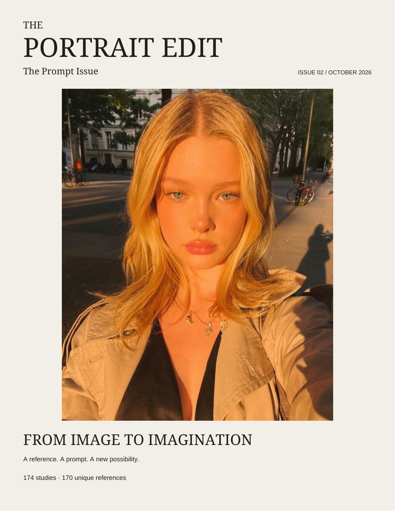

# The Portrait Edit

## Issue 02 - The Prompt Issue, editorial revision

[Open the current magazine](revised/The_Portrait_Edit_Issue_02_Editorial_Revision.pdf)

196 Letter-size pages organize 174 unchanged image prompts into nine themed chapters, with a glossary, linked contents and chapter directory, reviewed “Try this” lines, and chapter-specific opener copy.

The six reference-link and Source-field corrections for Studies 7-9 and 12-14 were explicitly approved after side-by-side visual review. Their images now match their intended prompt descriptions; the resolved pairing flags have been removed. Prompt wording, original notes, titles, numbers, chapter assignments, and attachment pixels remain unchanged. All rights-check flags and duplicate studies remain.

[Approved corrections](revised/pairing-corrections.json) · [Editorial review](revised/EDITORIAL_REVIEW.md) · [Changes](revised/EDITORIAL_CHANGES.md) · [Suggestions](revised/EDITORIAL_SUGGESTIONS.md) · [Rebuild instructions](revised/README.md)

Validation checks exact prompt/note preservation, the strictly limited source changes, all 174 contents entries, link/bookmark targets, body sizes, image pixels, and text/image boundaries. The six corrected study pages are rendered for visual review.

## Historical editions and audit

The [196-page baseline](revised/The_Portrait_Edit_Issue_02_Revised.pdf), [180-page draft](output/pdf/The%20Portrait%20Edit%20-%20Issue%2002%20-%20The%20Prompt%20Issue.pdf), and [original audit](revised/audit.md) remain unchanged. They document the earlier, uncorrected pairings. The [current Markdown](DALL-E.prompts/dalle-prompts.md) differs from the baseline only in the six approved links and corresponding Source fields; all [attachment files](DALL-E.prompts/Attachments) remain unchanged. The pre-correction source and editorial export remain in Git at commit `854d94a`.
